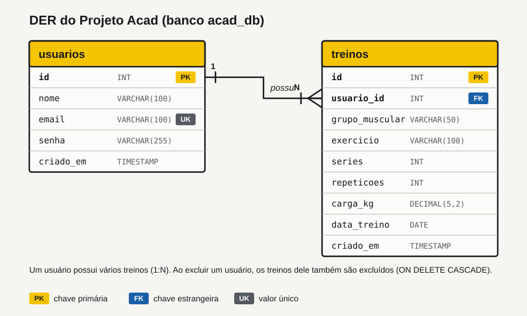

# Projeto Acad

Sistema web para registrar treinos de academia, feito em PHP e MySQL como projeto final da disciplina.

Cada pessoa cria a própria conta, entra e cadastra os treinos dela: exercício, grupo muscular, séries, repetições, carga e data. Dá para editar, excluir e filtrar a lista por grupo muscular e por período. O painel também mostra em quais dias das últimas 4 semanas teve treino.

Autor: Thiago Silva de Camargo

## O que foi usado

PHP com PDO, MySQL (pelo XAMPP), HTML e CSS puros, sem framework. O versionamento é com Git e GitHub.

## Como rodar

1. Abrir o XAMPP e ligar o Apache e o MySQL.
2. Colocar a pasta do projeto em `C:\xampp\htdocs\projeto-acad`.
3. No phpMyAdmin (`http://localhost/phpmyadmin`), ir em Importar e escolher o arquivo `sql/schema.sql`. Ele cria o banco `acad_db`, as tabelas e alguns dados de teste.
4. Se o MySQL não for o padrão do XAMPP, ajustar usuário e senha em `php/conexao.php`. Por padrão é `root` sem senha.
5. Abrir `http://localhost/projeto-acad/`.

Para entrar sem criar conta, tem dois usuários de teste, os dois com a senha `Teste@123`:

- `teste@acad.com`
- `maria@acad.com`

## Pastas

```
projeto-acad/
  index.php       login
  cadastro.php    criar conta
  painel.php      listar, filtrar, cadastrar e excluir treinos
  editar.php      editar um treino
  logout.php      sair
  css/style.css
  img/            logo e ilustrações
  php/conexao.php conexão com o banco
  sql/schema.sql  banco, tabelas e dados de teste
  docs/           DER e modelagem escrita
```

## Banco de dados

São duas tabelas: `usuarios` e `treinos`. Um usuário tem vários treinos, ligados por `treinos.usuario_id`. Se um usuário é apagado, os treinos dele vão junto (`ON DELETE CASCADE`).



Os campos de cada tabela estão descritos em [docs/modelagem.md](docs/modelagem.md).

A lista do painel usa um `INNER JOIN` entre `treinos` e `usuarios` para mostrar o nome do dono de cada treino.

## Segurança

- A senha é salva com `password_hash()` e conferida com `password_verify()`. Nada fica em texto puro no banco.
- Todas as consultas usam Prepared Statements do PDO.
- O que vem do banco é escapado com `htmlspecialchars()` antes de aparecer na tela.
- As páginas do sistema checam a sessão. Quem não está logado é mandado de volta para o login.
- Editar e excluir só funcionam em treinos do próprio usuário, porque o `usuario_id` entra na condição do `UPDATE` e do `DELETE`.
- A exclusão é feita por formulário POST, com confirmação, e não por link.
