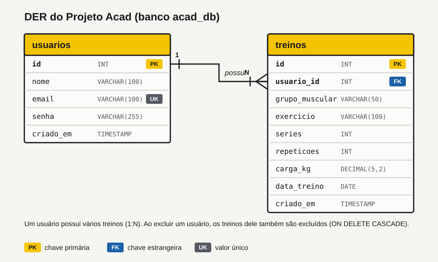

# Modelagem do banco de dados

Banco: `acad_db` (MySQL/MariaDB, engine InnoDB, charset `utf8mb4`).

O sistema registra os treinos de academia de cada usuário. O banco tem duas tabelas ligadas por chave estrangeira.



## Tabela `usuarios`

Guarda as pessoas que podem entrar no sistema.

| Campo | Tipo | Restrições | Descrição |
|---|---|---|---|
| `id` | INT | PK, AUTO_INCREMENT | Identificador do usuário |
| `nome` | VARCHAR(100) | NOT NULL | Nome exibido no painel |
| `email` | VARCHAR(100) | NOT NULL, UNIQUE | E-mail usado no login |
| `senha` | VARCHAR(255) | NOT NULL | Hash gerado com `password_hash()`, nunca a senha em texto puro |
| `criado_em` | TIMESTAMP | DEFAULT CURRENT_TIMESTAMP | Data e hora do cadastro |

## Tabela `treinos`

Guarda cada exercício registrado por um usuário.

| Campo | Tipo | Restrições | Descrição |
|---|---|---|---|
| `id` | INT | PK, AUTO_INCREMENT | Identificador do treino |
| `usuario_id` | INT | NOT NULL, FK para `usuarios(id)` | Dono do treino |
| `grupo_muscular` | VARCHAR(50) | NOT NULL | Ex.: Peito, Costas, Pernas |
| `exercicio` | VARCHAR(100) | NOT NULL | Ex.: Supino reto |
| `series` | INT | NOT NULL | Quantidade de séries |
| `repeticoes` | INT | NOT NULL | Repetições por série |
| `carga_kg` | DECIMAL(5,2) | DEFAULT 0.00 | Carga usada, em quilos |
| `data_treino` | DATE | NOT NULL | Dia em que o treino foi feito |
| `criado_em` | TIMESTAMP | DEFAULT CURRENT_TIMESTAMP | Data e hora do registro |

## Relacionamento

- Cardinalidade **1:N**: um usuário possui vários treinos, e cada treino pertence a um único usuário.
- Chave estrangeira: `treinos.usuario_id` referencia `usuarios.id` (`fk_treinos_usuarios`).
- Integridade: `ON DELETE CASCADE`. Ao excluir um usuário, os treinos dele são excluídos junto, sem deixar registros órfãos.

## Consulta com INNER JOIN

A listagem do painel cruza as duas tabelas para mostrar o nome do usuário ao lado de cada treino:

```sql
SELECT t.*, u.nome AS nome_usuario
FROM treinos t
INNER JOIN usuarios u ON t.usuario_id = u.id
WHERE t.usuario_id = :usuario_id
ORDER BY t.data_treino DESC, t.id DESC;
```

Os filtros por grupo muscular e por período acrescentam condições `AND` a essa mesma consulta, sempre com parâmetros do PDO.

## Script e dados de teste

O arquivo [`../sql/schema.sql`](../sql/schema.sql) cria o banco, as duas tabelas e insere dois usuários e oito treinos de teste.

| Usuário | E-mail | Senha |
|---|---|---|
| Usuário Teste | `teste@acad.com` | `Teste@123` |
| Maria Souza | `maria@acad.com` | `Teste@123` |

As senhas aparecem no banco apenas como hash.
